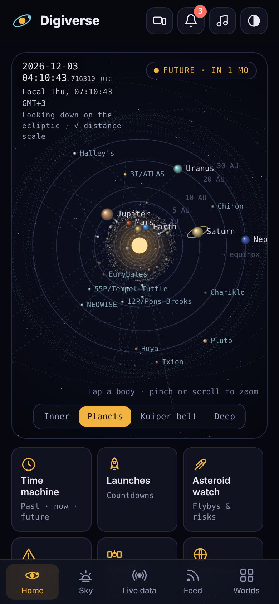
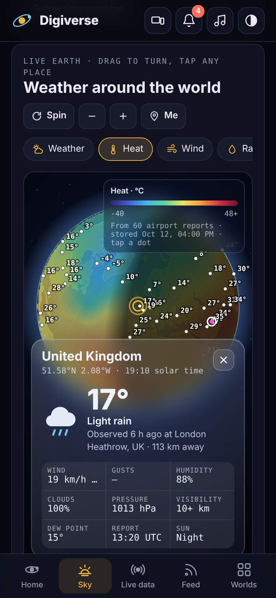
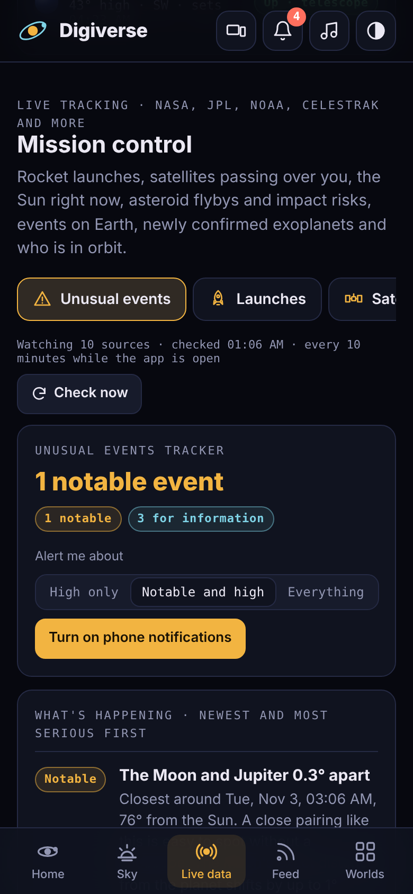

# Digiverse

**A live, animated guide to our solar system that you can install like an app.**

102 worlds on real orbits — 8 planets, 43 moons, 6 dwarf planets, 18 asteroids, 11 trans-Neptunian objects and 16 comets, including all three known interstellar visitors — plus 13 deep-space spacecraft, the live sky above you, mission control tracking from NASA, JPL and NOAA, and an unusual-events tracker that alerts you when something out of the ordinary happens beyond Earth.

<p>
  
  
  
</p>

## Features

- **Animated solar system** with a time machine (1800–2300), real-time mode with a microsecond clock, and zoom from the inner planets out to Sedna and the Voyagers.
- **Detail sheet for every world:** facts, live position, orbit data, moon-system diagram, live Wikipedia summary, NASA photo gallery and official JPL data.
- **Live Earth globe:** a rotating Earth with real day and night. Drag to turn, pinch to zoom, tap any place for a glass window with its live weather, 12-hour temperature, air quality and sunrise/sunset. Layers: Weather (clouds and rain), Heat, Wind, Rain, Clouds, Air quality, Earthquakes (USGS), Aurora (NOAA OVATION) and Fires & volcanoes (NASA EONET). Strong earthquakes (M6+) raise an alert.
- **Tonight's sky** for your location: sky map, Sun and Moon times, moon phase, visible planets, live space station position, clouds, aurora chances and a stargazing score.
- **Mission control:** unusual events, launches with countdowns, satellite passes over you, the Sun right now, asteroid watch, Earth events, exoplanets, crew in space, deep-space spacecraft, space agencies and NASA image search.
- **Unusual events tracker:** ten sources checked every 10 minutes, ranked High / Notable / Info, with pop-up, in-app and phone notifications.
- **Discovery feed** of solar-system news with alerts for new findings.
- **Ambient music:** five original space soundscapes generated live in the browser.
- **Themes:** Light, Dark and Blue neon. **Layouts:** Mobile (portrait), Tablet (landscape split view) or Auto.
- **Installable PWA:** works offline after the first visit, app shortcuts, update prompt, no build step, no tracking.

## Digiverse Live App

**[▶ Open the live app](https://soorajacontec.github.io/digiverse/)**

## Install it as an app

- **Android (Chrome, Edge, Samsung Internet):** tap **Install** in the app header, or the browser menu → *Install app*.
- **iPhone / iPad (Safari):** Share → **Add to Home Screen**. The app shows this tip once.
- **Windows, macOS, Linux (Chrome, Edge):** the install icon in the address bar, or the **Install** button.

Long-press the installed icon for shortcuts to *Tonight's sky*, *Unusual events*, *Live data* and *All worlds*.

PWA features need HTTPS, which GitHub Pages provides. Opening `index.html` straight from your disk works for browsing, but can't install or work offline.

## Run it locally

```bash
npx serve .          # or: python3 -m http.server 8080
```

Then open the address it prints. `localhost` counts as secure, so install and offline mode work there too.

## Deep links

Add these to the app address: `#earth`, `#quakes`, `#sky`, `#live`, `#watch`, `#launches`, `#spacecraft`, `#feed`, `#worlds`, `#time`, or a world's id such as `#saturn`, `#europa`, `#halley`, `#apophis`.

## Live data sources

| Area | Service | Key needed | Works straight from the browser |
|---|---|---|---|
| Planet positions, time machine, sky map | Computed in the app from NASA JPL orbital elements | — | yes |
| Asteroid, comet and TNO orbits | NASA JPL Small-Body Database (built in) | — | yes |
| Planet position check | JPL Horizons | no | needs relay |
| Comet / dwarf-planet orbit data | JPL Small-Body Database (SBDB) | no | needs relay |
| Asteroid flybys | JPL Close Approach (CAD) | no | needs relay |
| Impact-risk list | JPL Sentry | no | needs relay |
| Fireballs | JPL Fireball | no | needs relay |
| Deep-space probes | JPL Horizons spacecraft ephemerides | no | needs relay (stored positions used otherwise) |
| Solar flares, CMEs, storm alerts | NASA DONKI at ccmc.gsfc.nasa.gov/DONKI-API (moved from api.nasa.gov on 30 Sep 2026) | no | yes (relay optional) |
| Photo galleries and search | NASA Image and Video Library | no | yes |
| Natural events on Earth | NASA EONET | no | yes |
| Earth imagery | NASA GIBS (VIIRS true colour) | no | yes |
| The Sun right now | Helioviewer (NASA SDO); NOAA GOES-19 SUVI as backup | no | yes |
| X-ray flux, solar wind, NOAA scales, Kp | NOAA SWPC | no | yes |
| Satellites, ISS / Tiangong passes | CelesTrak TLEs + satellite.js | no | yes (relay optional) |
| ISS live position | Where the ISS at? | no | yes |
| Launches, people in space | The Space Devs Launch Library 2 (15 requests/hour, cached) | no | yes |
| Space news | Spaceflight News API | no | yes |
| Exoplanets | NASA Exoplanet Archive (TAP) | no | yes (relay optional) |
| Weather, city search, globe weather layers, air quality | Open-Meteo forecast, air-quality and geocoding APIs | no | yes |
| Weather backup (60 airports) | NOAA Aviation Weather Center METAR API | no | yes (relay optional) |
| Earthquakes | USGS earthquake feeds (M4.5+ week, M2.5+ day) | no | yes |
| Aurora forecast | NOAA SWPC OVATION | no | yes |
| Place names on the globe | OpenStreetMap Nominatim (only on your tap, max 1 per second, cached; can be switched off in Data settings); built-in Natural Earth country map offline | no | yes |
| Name of your GPS location | BigDataCloud client reverse geocoding (device location only, as its terms require) | no | yes |
| Summaries | Wikipedia REST API | no | yes |
| Space agencies directory | Built-in facts, with links to each agency's open-data portals | — | yes |

**Left out, and why:**
- *Portals rather than open web APIs:* ESA Earth Online and EVDC, JAXA EORC, ISRO Bhuvan, CSA / Open Government Canada, DLR (linked from each agency card instead).
- *Couldn't be verified:* NASA SSC Web Services.
- *Need an account or token:* N2YO, ESA DISCOS, Copernicus Data Space, Sentinel Hub, NASA Earthdata, FIRMS, NOAA NCEI, USGS EarthExplorer.
- *Research archives, not live feeds:* ESA Gaia, MAST, ESO, SIMBAD, VizieR, VO TAP services.
- *Full applications:* Aladin Lite, WorldWide Telescope, ESA Space Weather portal.
- *Superseded:* Open Notify (HTTP only), SpaceX API (no longer updated), NASA APOD (removed; NASA retires the legacy endpoint on 1 December 2026).

## Optional: the data relay for NASA JPL

NASA JPL's APIs don't send the CORS headers browsers require, so the app can't read them directly. `relay/worker.js` is a tiny Cloudflare Worker (free plan) that fetches them for you. It only forwards GET requests to a fixed allow list of science hosts, so it can't be used as an open proxy.

**Dashboard:** dash.cloudflare.com → Workers & Pages → Create → Worker → paste `relay/worker.js` → Deploy.
**Command line:** `npm i -g wrangler && cd relay && wrangler login && wrangler deploy`

Then open **Data settings** in Digiverse (bell → settings) and paste the worker address, for example `https://digiverse-relay.<you>.workers.dev`.

## Checking the data feeds

Open **Service status** (front-page tile, Data settings, or `#status`) to test every feed from your own device. Each shows *Working* with its response time, *Problem* with the reason (HTTP error, rate limit, blocked, wrong format), or *Needs relay* for NASA JPL.

Findings from the check on 12 Oct 2026, already handled in the app:
- NASA DONKI moved to `https://ccmc.gsfc.nasa.gov/DONKI-API/get/…`; the old `api.nasa.gov/DONKI` address now redirects to a notice page.
- The SDO "latest" images stopped updating on 21 Sep 2026, so the Sun backup now uses NOAA GOES-19 SUVI images (a new frame every 4 minutes).
- CelesTrak refuses repeat downloads within 2 hours and firewalls addresses with many errors, so the app waits 2 hours after any CelesTrak error and uses its stored ISS orbit meanwhile.
- NOAA's 1-minute Kp feed can lag; readings older than 3 hours are replaced by the 3-hourly Kp.
- BigDataCloud's free API may only name the device's own location, so tapped places on the globe use OpenStreetMap instead.
- Weather backup: when Open-Meteo can't be reached or hits its limit, the globe uses live airport weather reports (METAR) from NOAA's Aviation Weather Center for 60 airports worldwide. It shows the nearest airport's report for a tapped place and builds the Heat, Wind, Rain, Clouds and Weather maps from them. In Claude's preview, a stored set of these reports is shown instead.

## Unusual events tracker

While the app is open it checks these every 10 minutes and alerts you about anything unusual:

- Strong solar flares (GOES X-rays), NOAA radio-blackout / radiation / geomagnetic storm scales, fast solar wind or strongly southward Bz, Kp 5+
- NASA DONKI alerts: solar energetic particles, interplanetary shocks, X flares, CMEs faster than 1,000 km/s, magnetopause crossings
- Asteroids passing inside the Moon's orbit (JPL CAD) and Torino 1+ / Palermo > −2 impact risks (JPL Sentry)
- Deep-space news: supernovae, gamma-ray bursts, interstellar objects, outbursts
- Computed in the app: Moon and planet pairings within 1°, catalogued comets or asteroids within 0.1 AU of Earth

Browsers can't run checks while a web app is closed unless a push server is involved, so alerts arrive while Digiverse is open (including in the background on desktop).

## Project structure

```
index.html              the whole app (HTML, CSS, JavaScript)
sw.js                   service worker: offline support and updates
manifest.webmanifest    install metadata, shortcuts, screenshots
offline.html            shown if the app is opened offline before it was ever saved
404.html                sends unknown GitHub Pages paths back to the app
icons/                  app icons (SVG, PNG, maskable, Apple touch, favicon)
screenshots/            store-style screenshots for the install dialog
relay/                  optional Cloudflare Worker for NASA JPL APIs
.github/workflows/      GitHub Pages deployment
```

## Updating

Edit, commit and push. The page itself is always fetched fresh when online, so changes to `index.html` reach installed apps on their next launch, with an "updated" notice. If you change icons, screenshots or other static files, also raise `VERSION` in `sw.js` (for example from `digiverse-v18` to `digiverse-v19`).

## Privacy

No accounts, analytics or tracking. Settings, your location choice and alert history are stored only in your browser. Your location is used to calculate your sky and to ask Open-Meteo for local weather; if you use GPS, BigDataCloud is asked for the name of that place. When you tap the globe, the tapped coordinates go to Open-Meteo for weather and, unless you switch it off in Data settings, to OpenStreetMap Nominatim for the place name. Airport weather reports come from NOAA's Aviation Weather Center and don't include your location.

## Licence and credits

Code: MIT (see `LICENSE`). Data: NASA, JPL, NOAA SWPC, ESA, CelesTrak, The Space Devs, Spaceflight News API, Open-Meteo, Helioviewer, Where the ISS at? and Wikipedia (text under CC BY-SA 4.0), each under its own terms. Orbit calculations use NASA JPL's published elements; satellite positions use satellite.js. The globe uses d3-geo and topojson-client with Natural Earth country outlines (public domain) from world-atlas.
